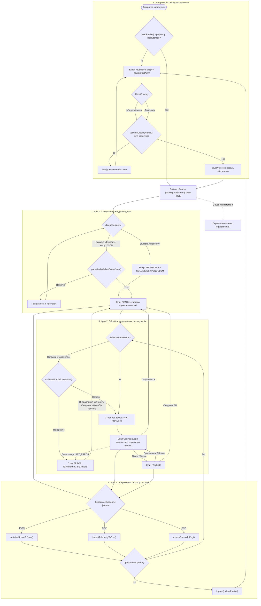

# Діаграма потоку користувача (User Flow)

> Матеріал для **Розділу 1 «Проєктування програмного продукту»** пояснювальної записки.
> Діаграма відображає потік, реалізований у застосунку: функції в підписах вузлів є реальними функціями коду.

**Рисунок 1.1 — Діаграма потоку користувача (User Flow) веб-застосунку симуляції фізичних процесів**

## Вербальний опис

Опис відповідає чотирьом групам вузлів діаграми (підграфам).

**1. Авторизація та ініціалізація сесії.** Під час запуску застосунок викликає `loadProfile()`: функція читає запис із `localStorage`, перевіряє його схему та повертає профіль або `null`. Пошкоджений, підроблений чи заблокований запис не спричиняє збою: користувач просто потрапляє на екран «Швидкий старт». Наявність валідного профілю веде одразу до робочої області. На екрані входу дослідник вводить ім’я або користується демо-входом. Кнопка «Увійти» неактивна, поки поле порожнє. Функція `validateDisplayName()` нормалізує ім’я, перевіряє довжину (2–40 символів) та білий список символів. За помилки з’являється повідомлення з `role="alert"`, і користувач лишається на екрані входу. За успіху профіль зберігається (`saveProfile()`), відкривається робоча область, а автомат симуляції перебуває в стані `IDLE`. Перемикання теми (`toggleTheme()`) доступне в будь-який момент і на потік не впливає.

**2. Крок 1: створення або введення даних.** Є два шляхи до стану `READY`:
- обрати один із трьох пресетів (балістика, пружні зіткнення, маятник) у вкладці «Пресети»;
- імпортувати готову сцену з JSON-файлу у вкладці «Експорт». Файл проходить `parseAndValidateSceneJson()` (розмір, структура, типи, діапазони). За помилки показується повідомлення з `role="alert"`, а стан застосунку не змінюється, тож користувач може обрати інше джерело.

Імпорт доступний і без обраного пресету, бо вкладка «Експорт» відкривається зі стану `IDLE`.

**3. Крок 2: обробка, редагування та симуляція.** У вкладці «Параметри» зміна кожного поля одразу перевіряється через `validateSimulationParams()`. Некоректне значення переводить автомат у `ERROR`: показується банер, поле підсвічується (`aria-invalid`), «Старт» недоступна. Вихід із помилки можливий виправленням значення, «Скиданням» або вибором пресету. Коректні дані (або відсутність змін) дозволяють запустити симуляцію кнопкою «Старт» чи клавішею Space. Під час руху користувач вмикає чи вимикає шари візуалізації, стежить за телеметрією, змінює параметри середовища та ставить симуляцію на паузу, а потім продовжує. «Скидання» (кнопка або R) з `RUNNING` і `PAUSED` повертає сцену на початок. Якщо інтегратор повертає нескінченні значення, автомат аварійно переходить у `ERROR` (пунктирна лінія на діаграмі).

**4. Крок 3: збереження, експорт та вихід.** Вкладка «Експорт» пропонує три формати: конфігурація сцени (JSON), журнал телеметрії (CSV) та знімок полотна (PNG). Експорт доступний зі станів `READY`, `RUNNING` і `PAUSED`, тобто в усіх станах, де є сцена. Після експорту користувач обирає: повернутися до роботи або вийти з профілю. На діаграмі повернення показано у вузол «Змінити параметри?» як спрощення: фактично можна також просто продовжити спостереження або скинути сцену. Вихід із профілю викликає `clearProfile()` і повертає на екран «Швидкий старт», тому на пристрої не залишається даних попереднього дослідника. Кнопка «Вийти» доступна в будь-який момент роботи (пунктирна лінія), а не лише після експорту.

## Точки розгалуження (валідації)

| Вузол | Перевірка | Успіх | Помилка |
|---|---|---|---|
| `loadProfile()` | Схема профілю у сховищі | Робоча область | Екран «Швидкий старт» |
| `validateDisplayName()` | Довжина, білий список символів | Профіль збережено | `role="alert"`, повернення до вводу |
| `parseAndValidateSceneJson()` | Розмір, ключі, типи, діапазони | Стан `READY` | `role="alert"`, стан без змін |
| `validateSimulationParams()` | Скінченність і діапазони | Параметри застосовано | Стан `ERROR` |
| `isWorldFinite()` | Скінченність стану світу | Цикл триває | `SET_ERROR`, стан `ERROR` |