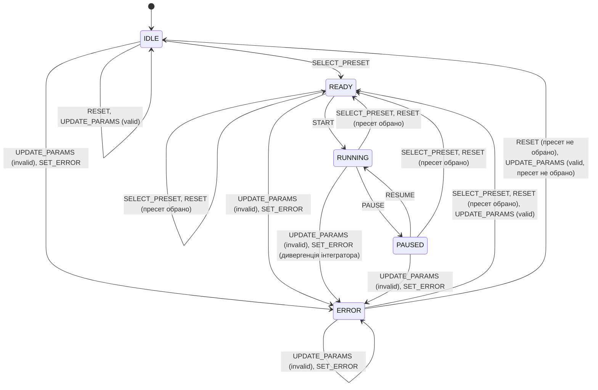

# Діаграма станів контролера симуляції (State Diagram)

> Матеріал для **Розділу 1 «Проєктування програмного продукту»** пояснювальної записки.
> Контролер реалізовано чистою функцією `simulationReducer(state, action)` та хуком `useReducer` за шаблоном `types` + `actionCreators` (Яскевич В. О. [[1]], с. 28–31).

**Рисунок 1.2 — Діаграма станів (State Diagram) контролера симуляції**

*Примітка до рисунка.* Самоперетини `UPDATE_PARAMS (valid)` у станах `READY`, `RUNNING` і `PAUSED` на діаграмі не показано (стан не змінюється, оновлюються лише параметри); їх наведено в таблиці 1.1. Умова «пресет обрано» означає `selectedPreset !== null`, «пресет не обрано» означає `selectedPreset === null`. Дивергенція інтегратора фіксується перевіркою `!isWorldFinite(world)` у циклі анімації.

## Таблиця переходів

**Таблиця 1.1 — Переходи скінченного автомата контролера симуляції**

| Поточний стан | Подія / дія `action.type` | Умова (guard) | Наступний стан | Реакція інтерфейсу |
|---|---|---|---|---|
| `IDLE` | `SELECT_PRESET` | — | `READY` | З’являється полотно та панель телеметрії, «Старт» стає доступною |
| `IDLE` | `START`, `PAUSE`, `RESUME` | — | `IDLE` (ігнорується) | Кнопки керування неактивні |
| `IDLE` | `RESET` | `selectedPreset === null` | `IDLE` | Параметри за замовчуванням; кнопка «Скидання» неактивна |
| `IDLE` | `UPDATE_PARAMS` | valid | `IDLE` | Параметри оновлено |
| `READY` | `START` | — | `RUNNING` | Запускається цикл `requestAnimationFrame`, «Пауза» доступна |
| `READY` | `PAUSE`, `RESUME` | — | `READY` (ігнорується) | Без змін |
| `READY` | `SELECT_PRESET` | — | `READY` | Сцена створюється заново для нового пресету |
| `READY` | `RESET` | `selectedPreset !== null` | `READY` | Сцена та журнал телеметрії скидаються, параметри за замовчуванням |
| `READY` | `UPDATE_PARAMS` | valid | `READY` | Параметри оновлено, сцена перестворюється |
| `RUNNING` | `PAUSE` | — | `PAUSED` | Цикл зупинено, кадр лишається на полотні; перша кнопка «Продовжити» |
| `RUNNING` | `START`, `RESUME` | — | `RUNNING` (ігнорується) | Без змін |
| `RUNNING` | `SELECT_PRESET` | — | `READY` | Перехід на інший пресет, сцена з початку |
| `RUNNING` | `RESET` | `selectedPreset !== null` | `READY` | Сцена з початку, журнал очищено |
| `RUNNING` | `UPDATE_PARAMS` | valid | `RUNNING` | Параметри середовища діють наживо |
| `PAUSED` | `RESUME` | — | `RUNNING` | Цикл відновлюється без «стрибка» часу |
| `PAUSED` | `START`, `PAUSE` | — | `PAUSED` (ігнорується) | Без змін |
| `PAUSED` | `SELECT_PRESET`, `RESET` | `selectedPreset !== null` для `RESET` | `READY` | Сцена з початку |
| `PAUSED` | `UPDATE_PARAMS` | valid | `PAUSED` | Параметри оновлено |
| `ERROR` | `START`, `PAUSE`, `RESUME` | — | `ERROR` (ігнорується) | «Старт» неактивна |
| `ERROR` | `SELECT_PRESET` | — | `READY` | Помилки очищено |
| `ERROR` | `RESET` | `selectedPreset !== null` / `=== null` | `READY` / `IDLE` | Помилки очищено, параметри за замовчуванням |
| `ERROR` | `UPDATE_PARAMS` | valid | `READY` / `IDLE` | Банер зникає, поле більше не підсвічується |
| будь-який | `UPDATE_PARAMS` | invalid | `ERROR` | Банер `role="alert"`, поля з `aria-invalid`; у `state.params` лишається останній валідний набір |
| будь-який | `SET_ERROR` | — (зокрема `!isWorldFinite`) | `ERROR` | Банер із повідомленням, цикл анімації зупинено |

## Опис станів

**`IDLE`.** Початковий стан: пресет не обрано. Полотно замінено підказкою, кнопки «Старт», «Пауза» та «Скидання» неактивні, гарячі клавіші Space і R нічого не роблять.

**`READY`.** Пресет обрано, параметри валідні, симуляцію можна запускати. Цей стан завжди означає початок: сцена створюється заново з поточних параметрів. Тому зміна початкових умов (кут пострілу, довжина маятника) застосовується саме тут.

**`RUNNING`.** Працює цикл `requestAnimationFrame`: фізика просувається фіксованим кроком, полотно перемальовується, телеметрія надходить приблизно п’ять разів на секунду. Параметри середовища (гравітація, опір, швидкість часу) можна змінювати наживо.

**`PAUSED`.** Цикл зупинено, поточний кадр і стан світу збережено. Перемикачі шарів і тема перемальовують полотно й на паузі. Продовження можливе кнопкою або клавішею Space.

**`ERROR`.** Дані некоректні або інтегратор став нестабільним. Користувач бачить причину в банері, а запуск заблоковано. Остання валідна конфігурація зберігається в `state.params`, тому рушій ніколи не отримує некоректних значень.

## Гарячі клавіші та кнопки

Space виконує `START` у `READY`, `PAUSE` у `RUNNING` та `RESUME` у `PAUSED`. R виконує `RESET` у будь-якому стані, крім `IDLE`. Клавіші ігноруються, якщо фокус у полі вводу чи на кнопці. Доступність кнопок виведено зі стану: «Старт» активна в `READY` і `PAUSED`, «Пауза» у `RUNNING`, «Скидання» у всіх станах, крім `IDLE`.