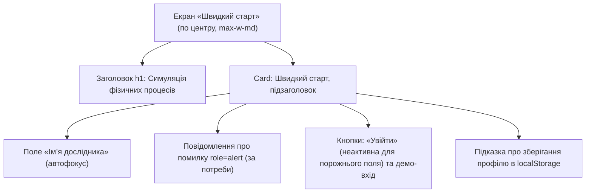
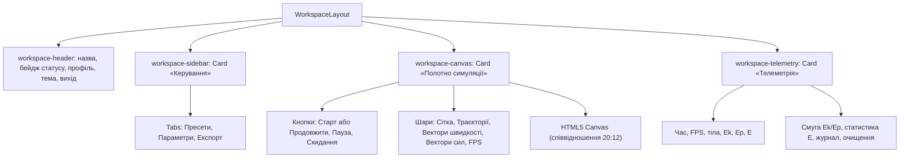
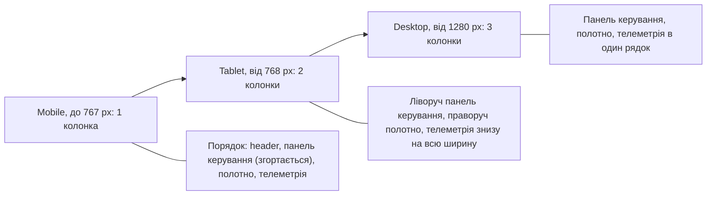

# Каркаси екранів (Wireframes)

> Матеріал для **Розділу 3 «Керівництво користувача» → «Огляд інтерфейсу» → «Головний екран»**.
> Каркас показує схематичне розташування кнопок, вкладок, полів і таблиць без детального дизайну.
> Для вставлення у Word блоки `text` слід оформлювати моноширинним шрифтом (Courier New або Consolas), а блоки `mermaid` експортувати як зображення.

## 3.1. Екран авторизації дослідника («Швидкий старт»)



```text
┌──────────────────────────────────────────────────┐
│  Симуляція фізичних процесів                     │
│                                                  │
│  ┌────────────────────────────────────────────┐  │
│  │ Швидкий старт                              │  │
│  │ Створіть профіль дослідника                │  │
│  │                                            │  │
│  │ Ім’я дослідника                            │  │
│  │ [____________________________________]     │  │
│  │ ! повідомлення про помилку (role=alert)    │  │
│  │                                            │  │
│  │ [ Увійти ]  [ Демо-вхід ]                  │  │
│  │                                            │  │
│  │ Профіль зберігається лише у браузері.      │  │
│  └────────────────────────────────────────────┘  │
│                                                  │
└──────────────────────────────────────────────────┘
```

**Рисунок 3.1 — Каркас екрана авторизації дослідника («Швидкий старт») (а — структурна схема підпорядкування зон; б — схематичне розташування елементів)**

**Опис.** Екран складається з заголовка та картки з формою. Поле імені одразу отримує фокус. Кнопка «Увійти» неактивна, доки поле порожнє. Повідомлення про помилку з’являється лише за недопустимого імені. Кнопка демо-входу авторизує користувача без введення даних.

## 3.2. Головний екран робочої області (Desktop, 3 колонки)



```text
┌────────────────────────────────────────────────────────────────────────────────┐
│ Симуляція фізичних процесів [IDLE]                  Дослідник  [Тема]  [Вийти] │
├──────────────────────────┬──────────────────────────────┬──────────────────────┤
│ Керування                │ Полотно симуляції            │ Телеметрія           │
│ Пресети/Парам./Експорт   │ [Старт][Пауза][Скидання]     │ Час, с: 0.00         │
│ (•) Балістичний рух      │ [Сітка][Траєкт.][Вектори]    │ FPS: -               │
│ ( ) Пружні зіткнення     │ HTML5 Canvas (сітка, тіла,   │ Ek, Дж: 0.00         │
│ ( ) Гармонічний маятник  │ вектори, траєкторії)         │ Ep, Дж: 0.00         │
│                          │                              │ E = Ek + Ep: 0.00    │
│ Space / R: гарячі клавіші│                              │ [Ek====|Ep----]      │
│                          │                              │ Журнал: t, E, FPS    │
│                          │                              │ [Очистити журнал]    │
└──────────────────────────┴──────────────────────────────┴──────────────────────┘
```

**Рисунок 3.2 — Каркас головного екрана робочої області (Desktop, 3 колонки: Header + зона керування `Tabs` + полотно симуляції `Canvas` + панель телеметрії) (а — структурна схема; б — схематичне розташування елементів)**

## 3.3. Адаптивна трансформація каркаса



Tablet (2 колонки):

```text
┌──────────────────────────────────────────────────────────┐
│ Симуляція фізичних процесів [IDLE]          [Тема][Вийти]│
├────────────────────────┬─────────────────────────────────┤
│ Керування              │ Полотно симуляції               │
│ Пресети/Парам./Експорт │ [Старт][Пауза][Скидання]        │
│ (•) Балістичний рух    │ HTML5 Canvas                    │
│ ( ) Пружні зіткнення   │                                 │
│ ( ) Гармонічний маятник│                                 │
├────────────────────────┴─────────────────────────────────┤
│ Телеметрія: час, FPS, Ek, Ep, E                          │
│ Журнал телеметрії [Очистити]                             │
└──────────────────────────────────────────────────────────┘
```

Mobile (1 колонка, панель керування згортається):

```text
┌────────────────────────────────┐
│ Симуляція [IDLE]  [Тема][Вийти]│
├────────────────────────────────┤
│ [Сховати панель]               │
│ Пресети/Парам./Експорт         │
│ (•) Балістичний рух            │
│ ( ) Пружні зіткнення           │
│ ( ) Гармонічний маятник        │
├────────────────────────────────┤
│ Полотно симуляції              │
│ [Старт][Пауза][Скидання]       │
│ HTML5 Canvas                   │
├────────────────────────────────┤
│ Телеметрія                     │
│ Час, с: 0.00   FPS: -          │
│ E = Ek + Ep: 0.00              │
└────────────────────────────────┘
```

**Рисунок 3.3 — Адаптивна трансформація каркаса для планшетів (Tablet, 2 колонки) та мобільних пристроїв (Mobile, 1 колонка зі згортанням панелі керування)**

*Примітка.* Брейкпоінти Tailwind CSS: `md` від 768 px, `xl` від 1280 px. У проміжку 1024–1279 px застосовується двоколонкова розкладка планшета. На вузьких екранах кнопки полотна переносяться на новий рядок.

## Опис робочих зон

**Зона 1: верхня панель (`workspace-header`).**
- Назва застосунку.
- Бейдж стану симуляції (`IDLE`, `READY`, `RUNNING`, `PAUSED`, `ERROR`), колір якого відповідає стану.
- Ім’я дослідника, кнопка перемикання теми (іконка сонця або місяця) та кнопка «Вийти».

**Зона 2: бічна панель керування (`workspace-sidebar`).** На мобільних зверху є кнопка «Сховати панель» / «Показати панель». Далі картка «Керування» з трьома вкладками:
- «Пресети»: три картки-кнопки (балістичний рух, пружні зіткнення, гармонічний маятник), обрана підсвічується.
- «Параметри»: група «Середовище» (прискорення вільного падіння, опір, множник часу, крок інтегрування, коефіцієнт відновлення стін), група параметрів обраного пресету та кнопка «Відновити типові значення». Кожне поле показує допустимий діапазон, а помилку підсвічує червоним.
- «Експорт»: секції «Конфігурація сцени (JSON)» (експорт та імпорт), «Журнал телеметрії (CSV)» із кількістю записів, «Знімок полотна (PNG)» та повідомлення про результат операції.

**Зона 3: центральна зона візуалізації (`workspace-canvas`).**
- У заголовку картки кнопки «Старт» (у стані паузи «Продовжити»), «Пауза» та «Скидання».
- Банер помилки (у стані `ERROR`), назва обраного пресету.
- Перемикачі шарів «Сітка», «Траєкторії», «Вектори швидкості», «Вектори сил» і бейдж FPS.
- Полотно зі співвідношенням сторін 20:12 та підказка про гарячі клавіші Space і R.
- До вибору пресету замість полотна показується підказка «Оберіть пресет…».

**Зона 4: панель телеметрії (`workspace-telemetry`).**
- Числові показники: час, FPS, кількість тіл, Ek, Ep та E = Ek + Ep.
- Двоколірна смуга розподілу енергії.
- Статистика енергії (максимум, мінімум, середнє, дрейф ΔE).
- Журнал останніх записів (найновіший зверху) і кнопка «Очистити журнал».